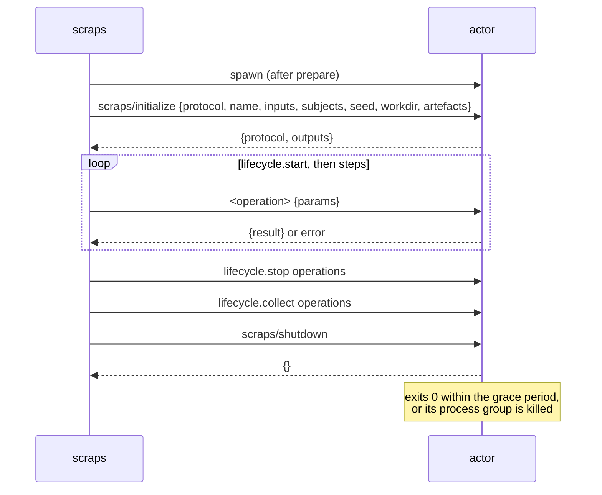
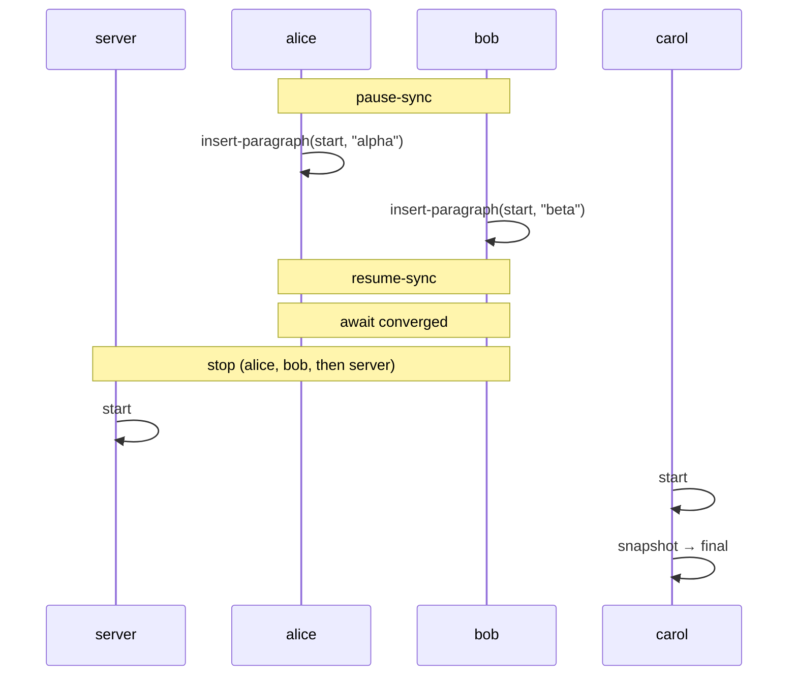

# Scraps

**Reproduce it once. Know the moment it comes back.**

Scraps runs small, deterministic scenarios against the dependencies you don't control,
and remembers how each scenario behaves at every version. When a vendor fixes the bug
you reported, Scraps tells you. When they quietly regress it two releases later, Scraps
tells you first, before your customers do.

A scenario is one YAML file that someone can read without knowing how anything else works:
who is involved, what they do, in what order, and what "correct" and "broken" look like.

```yaml
id: DOC-0042
title: Concurrent inserts at document start drop a paragraph

actors:
  server: { uses: collab-server, with: { document: "${{ fixtures.doc }}" } }
  alice:  { uses: editor, with: { server: server } }
  bob:    { uses: editor, with: { server: server } }

steps:
  - alice, bob: pause-sync
  - alice: { insert-paragraph: { at: start, text: alpha } }
  - bob:   { insert-paragraph: { at: start, text: beta } }
  - alice, bob: resume-sync
  - alice, bob: { await: converged }
  - alice: { snapshot: { as: final } }

outcomes:
  correct:   { final: { has-paragraphs: [alpha, beta] } }
  drops-one: { final: { has-one-of: [alpha, beta] } }

history:
  - { when: { docengine: "<2.31.0" },  expect: correct }
  - { when: { docengine: ">=2.31.0" }, expect: drops-one }
```

> The name comes from building something that works out of a box of scraps. Every
> scenario is a minimal reproduction: a synthetic fixture that triggers exactly one
> bug and nothing else.

---

## Contents

- [Why](#why)
- [Concepts](#concepts)
- [Install](#install)
- [Quick start](#quick-start)
- [Project config: `scraps.yaml`](#project-config-scrapsyaml)
- [Scenarios](#scenarios)
- [Outcomes, history and verdicts](#outcomes-history-and-verdicts)
- [Actors](#actors)
- [The actor protocol](#the-actor-protocol)
- [Checkers](#checkers)
- [Editor support and validation](#editor-support-and-validation)
- [CLI](#cli)
- [Reports](#reports)
- [Running in CI](#running-in-ci)
- [Recipes](#recipes)
- [Writing good scenarios](#writing-good-scenarios)
- [Prior art](#prior-art)

---

## Why

You found a bug in a library you depend on. You worked out a reproduction, reported it
upstream, shipped a workaround, and moved on. Then one of three things happens:

1. **They fix it** and you never notice. Your workaround stays around forever.
2. **They fix it, then regress it** in a later release. You find out from a customer.
3. **They change it.** It's still broken, but differently, and your workaround no longer
   covers it.

A normal test suite can't tell these apart. A test is pass or fail, and an "expected
failure" that fails for an entirely different reason still looks green.

Scraps tracks **what a scenario does at each version**, not just pass or fail:

- Each scenario names its outcomes: one correct outcome, plus the specific ways it's
  known to break.
- Each scenario records which outcome to expect at which version.
- Every run is compared against that record and gets a verdict: as expected, fixed,
  regressed, changed, or unrecognised.

Scenarios can involve several cooperating processes: a server and two clients, a writer
and a later reader, a client at one version against a server at another. Scraps starts
them in dependency order, waits until each one is actually ready, runs the steps
against them one at a time in a fixed order, then stops them in reverse order and
collects what they leave behind.

## Concepts

| Concept | What it is |
|---|---|
| **Subject** | A versioned dependency under test, such as `docengine`. You declare subjects in `scraps.yaml`. Each run resolves every subject to a concrete version. |
| **Scenario** | One reproduction: fixtures, actors, a timeline of steps, named outcomes, and a history. One directory, one `scenario.yaml`. |
| **Actor** | A process that takes part in a scenario: a server, a client, a CLI wrapper. Its definition (`actor.yaml`) declares its inputs, lifecycle and operations, and can be shared between projects. |
| **Step** | One line of the timeline: *who* does *what*. Every step is addressed to an actor. |
| **Outcome** | A named, checkable end state. `correct` is reserved. Every other outcome is a known way of being wrong. |
| **History** | An ordered list of version conditions mapped to the outcome expected under them. |
| **Verdict** | How a run's actual outcome compares to the expected one. |
| **Checker** | An actor with no lifecycle that answers questions about artefacts, such as whether this snapshot contains these paragraphs. |

## Install

Scraps is a single binary for linux and macOS (amd64 and arm64), published as GitHub
release archives that mise's `github:` backend installs directly.

```bash
mise use -g github:lighthousenz/scraps
```

Actors may need their own runtimes (Node, Python, and so on). Scraps provisions them
through [mise](https://mise.jdx.dev), so mise needs to be on the machine that runs the
scenarios.

## Quick start

```bash
scraps init        # writes scraps.yaml and an example scenario
scraps lock        # resolves actor references into scraps.lock
scraps schema      # generates .scraps/schema.json for your editor
scraps run --subject docengine=2.31.0
```

```text
scraps 1.4.0 · docengine 2.31.0 · seed 81723

  DOC-0017  Table cell merge loses borders        as-expected   correct      0.8s
  DOC-0042  Concurrent inserts drop a paragraph   as-expected   drops-one    1.9s
  DOC-0051  Tracked change survives reject-all    REGRESSED     correct → keeps-insertion
                                                                             1.2s

  3 scenarios · 2 as-expected · 1 regressed
  artefacts: .scraps/runs/2026-11-02T09-14-03Z/
  exit 1 (regressed is in --fail-on)
```

A project looks like this:

```text
scraps.yaml               project config: subjects, links, actor sources, checkers
scraps.lock               pinned actor and checker references
actors/                   your own actor definitions
checkers/                 your own checkers
scenarios/
  DOC-0042-concurrent-inserts/
    scenario.yaml
    fixtures/
      two-paragraphs/     synthetic input, committed in reviewable form
.scraps/                  generated: schema, caches, run artefacts (gitignore it)
```

## Project config: `scraps.yaml`

```yaml
# scraps.yaml
version: 1

subjects:
  docengine:
    scheme: semver
    resolve: { env: DOCENGINE_VERSION }   # or pass --subject docengine=2.31.0

links:
  ticket:
    pattern: '^ENG-\d+$'
    url: https://linear.app/acme/issue/{value}
    required: true
  upstream:
    pattern: '^(?<repo>[\w.-]+/[\w.-]+)#(?<n>\d+)$'
    url: https://github.com/{repo}/issues/{n}
    required-when: { expects-not: correct }

actors:
  collab-server: github:acme/scraps-actors/hocuspocus@v1.2.0
  editor:        github:acme/scraps-actors/yjs-editor@v1.2.0
  docengine-cli: ./actors/docengine-cli

checkers:
  - github:acme/scraps-actors/docx-checker@v1.2.0

defaults:
  step-timeout: 10s
  ready-timeout: 30s
  fail-on: [regressed, changed, unrecognised, broken, fixed]
```

### Subjects

A subject is anything with versions whose behaviour you want to track. You can declare
several, and history conditions can refer to more than one of them. That lets you
express cross-version cases, such as a client below 2.30 talking to a server at 2.31 or
later.

| Key | Meaning |
|---|---|
| `scheme` | `semver` (ranges like `>=2.31.0 <2.33.0`) or `exact` (string equality). |
| `resolve` | Where the version comes from when `--subject` isn't given: `{ env: NAME }` or `{ value: "2.31.0" }`. |

### Links

The links block is yours. You decide which link types your scenarios carry, and how
each one is validated and rendered. Scraps folds these definitions into the generated
schema, so your editor autocompletes and validates them, and reports turn them into
clickable URLs.

| Key | Meaning |
|---|---|
| `pattern` | A regex the value has to match. Named groups are available to `url`. |
| `url` | A URL template. `{value}` is the whole value; `{name}` is a named group. |
| `required` | Every scenario has to carry this link. |
| `required-when` | A conditional requirement. `{ expects-not: correct }` means any scenario where some history entry expects an outcome other than `correct` has to carry this link. |

Validation is offline: Scraps checks patterns and presence, and never calls out to
check that a ticket exists.

### Actor and checker sources

These map a short name to a definition. A source can be:

- a local path: `./actors/docengine-cli`
- a Git reference: `github:owner/repo/path@ref`

Git references are resolved once by `scraps lock` and pinned by commit and content hash in
`scraps.lock`. Fetched content is cached under `.scraps/sources/`. In CI, run
`scraps lock --frozen`: it fetches exactly what the lock names, checks the hashes, and
fails rather than change the lock. A harness whose job is catching regressions can't let its own actors
change underneath it.

## Scenarios

```yaml
# scenarios/DOC-0042-concurrent-inserts/scenario.yaml
# yaml-language-server: $schema=../../.scraps/schema.json
id: DOC-0042
title: Concurrent inserts at document start drop a paragraph
symptom: >
  Two users each insert a paragraph at the start while out of sync with
  each other. After they sync, only one of the paragraphs survives.
links:
  ticket: ENG-3901
  upstream: acme/docengine#1234
tags: [collab, lists]

fixtures:
  doc: fixtures/two-paragraphs/

actors:
  server: { uses: collab-server, with: { document: "${{ fixtures.doc }}" } }
  alice:  { uses: editor, with: { server: server } }
  bob:    { uses: editor, with: { server: server } }
  carol:  { uses: editor, with: { server: server }, start: on-demand }

steps:
  - alice, bob: pause-sync
  - alice: { insert-paragraph: { at: start, text: alpha } }
  - bob:   { insert-paragraph: { at: start, text: beta } }
  - alice, bob: resume-sync
  - alice, bob: { await: converged }
  - server: stop          # stops alice and bob first; persists the document
  - server: start         # reloads what it persisted
  - carol: start          # a fresh client sees what a new user would see
  - carol: { snapshot: { as: final } }

outcomes:
  correct:   { final: { has-paragraphs: [alpha, beta] } }
  drops-one: { final: { has-one-of: [alpha, beta] } }

history:
  - { when: { docengine: "<2.31.0" },  expect: correct }
  - { when: { docengine: ">=2.31.0" }, expect: drops-one }
```

### Actors in a scenario

Each entry names a participant and says which actor definition plays it.

| Key | Meaning |
|---|---|
| `uses` | An actor name from `scraps.yaml`. |
| `with` | Inputs for the actor's `inputs`. An input of type `actor` takes the name of another participant. |
| `start` | `auto` (the default) starts the actor before the first step. `on-demand` leaves it stopped until a `start` step. |

**Dependencies come from references.** `alice` takes `server` as an input, so `server`
starts first and is ready before `alice` starts. `alice` stops before `server` stops.
Actors with no dependency between them start in parallel. Cycles are rejected when the
scenario is validated.

### Steps

Every step has the same shape: **who: does what**.

```yaml
- alice: pause-sync                                    # an operation with no params
- alice: { insert-paragraph: { at: start, text: x } }  # an operation with params
- alice, bob: resume-sync                              # the same operation on each, in order
- alice, bob: { await: converged }                     # wait for a group condition
- server: stop                                         # lifecycle
- carol: start                                         # lifecycle
```

A step runs only after the previous one has finished. The timeline is the only thing
that drives actors once they're ready. Actors never act on their own initiative, so the
same scenario does the same thing every time.

Every actor has three built-in operations:

| Built-in | What it does |
|---|---|
| `start` | Starts any stopped dependencies first, then runs the actor's start phase and blocks until its `ready` condition holds. An actor can be started again after it has been stopped. |
| `stop` | Stops any running dependents first, in reverse dependency order. Then runs the actor's stop phase, then its collect phase, then shuts the process down. |
| `await` | Blocks until a condition holds, or fails the step at the timeout. `alice: { await: synced }` checks one actor; `alice, bob: { await: converged }` checks a group. The actor definition declares which conditions exist. |

Actor definitions can't define operations called `start`, `stop` or `await`.

**When a step fails, the timeline stops.** The remaining steps are skipped, every actor
is still stopped and collected in reverse order, and then outcomes are evaluated with
the failure recorded. A crash is often the bug itself, so an outcome can match on it:

```yaml
outcomes:
  correct:      { final: { has-paragraphs: [alpha, beta] } }
  insert-throws:
    step-error: { actor: bob, operation: insert-paragraph, message: { matches: "Cannot read properties" } }
```

A `step-error` matcher sets at least one of `actor`, `operation` and `message`, and
matches only if a step failed and every field it sets agrees. `message` takes one of two
forms:

- a string, which must equal the recorded message exactly;
- `{ matches: <regex> }`, which matches if the regex finds a match anywhere in the
  message.

### Expressions

Values can reference other values with `${{ }}`. It's deliberately small: references
only, with no operators, conditionals or functions.

| Reference | Value |
|---|---|
| `fixtures.<name>` | Absolute path to a fixture. |
| `subjects.<name>` | The resolved version of a subject. |
| `actors.<name>.outputs.<key>` | An output the actor published when it became ready, such as a URL. |
| `inputs.<name>` | Inside an actor definition: one of its resolved inputs. |
| `run.id`, `run.seed`, `run.workdir`, `run.artefacts` | Facts about the current run. |

## Outcomes, history and verdicts

### Outcomes

An outcome is a set of checks against the artefacts a run produced. `correct` is
required. Every other outcome names one specific known failure, and it should be
specific enough to tell it apart from other failures:

```yaml
outcomes:
  correct:     { final: { has-paragraphs: [alpha, beta] } }
  drops-one:   { final: { has-one-of: [alpha, beta] } }
  duplicates:  { final: { paragraph-count: { greater-than: 4 } } }
```

Outcomes have to be mutually exclusive. If more than one matches, the run is
`unrecognised` and Scraps reports which outcomes overlapped.

### History

History is checked from top to bottom, and the first `when` that matches decides the
expected outcome. A `when` can refer to any subject:

```yaml
history:
  - { when: { docengine: "<2.31.0" },                  expect: correct }
  - { when: { docengine: ">=2.31.0 <2.33.0" },         expect: drops-one }   # regressed in 2.31
  - { when: { docengine: ">=2.33.0" },                 expect: correct }     # fixed again in 2.33
```

If no entry matches, the expected outcome is `correct`. When the behaviour changes,
you change one line, so `git log` on the scenario reads as the bug's history.

### Verdicts

| Verdict | Expected | Actual |
|---|---|---|
| `as-expected` | X | X |
| `fixed` | a failure outcome | `correct` |
| `regressed` | `correct` | a failure outcome |
| `changed` | failure A | failure B |
| `unrecognised` | anything | no outcome matched, or more than one did |
| `broken` | anything | the run itself failed: an actor never became ready, broke the protocol, or crashed outside a step |

`broken` is never matched against outcomes. If the harness itself fails, the run is
reported as `broken`, not as a known failure, so an infrastructure problem can never
pass for an expected bug.

`--fail-on` decides which verdicts make `scraps run` exit non-zero. The default treats
every verdict other than `as-expected` as a failure, including `fixed`. An unexpected
pass means the history is out of date, and the cheapest time to update it is now.

## Actors

An actor definition describes how to run one kind of participant, so that scenarios
don't have to.

```yaml
# scraps-actors/yjs-editor/actor.yaml
name: yjs-editor
description: A Yjs client connected to a collab server, with controllable sync.
protocol: 1

tools:                         # provisioned with mise; the actor runs under `mise exec`
  node: 22.11.0

prepare:                       # once per subject version, cached under .scraps/cache
  run: npm ci && npm install docengine@${{ subjects.docengine }}
  cache-key: [docengine]

run: node ./main.mjs           # the process; speaks the actor protocol on stdio

inputs:
  server: { type: actor, kind: collab-server }
  room:   { type: string, default: doc }

outputs:
  client-id: { type: string }

lifecycle:
  start:
    - connect: { url: "${{ inputs.server.outputs.url }}", room: "${{ inputs.room }}" }
  ready: synced
  stop:
    - disconnect
  collect:
    - snapshot: { as: final-state }

conditions:
  synced:    { call: status, until: { synced: true }, every: 50ms }
  converged: { call: digest, all-equal: true, every: 50ms }   # for groups

operations:
  connect:          { params: { url: { type: string }, room: { type: string } } }
  disconnect:       {}
  pause-sync:       {}
  resume-sync:      {}
  insert-paragraph: { params: { at: { enum: [start, end] }, text: { type: string } } }
  status:           { returns: { synced: { type: boolean } } }
  digest:           { returns: { value: { type: string } } }
  snapshot:         { params: { as: { type: string } }, artefact: true }
```

### Lifecycle

The conductor owns the order of phases. The actor definition says what happens in each.

| Phase | When | What |
|---|---|---|
| `prepare` | Before the run, once per distinct set of `cache-key` subject versions | A shell command. Installs the subject version under test. Cached (see [The prepared directory](#the-prepared-directory)). |
| `start` | After the actor's dependencies are ready | Operations called in order, such as connecting to a server. |
| `ready` | After `start` | A named condition. Scraps waits until it holds or `ready-timeout` passes. It never sleeps a fixed time. |
| `stop` | On a `stop` step, or at the end of the run in reverse dependency order | Operations called in order. |
| `collect` | Straight after `stop` | Operations that write artefacts. Outcomes are evaluated after every actor has been collected. |

### The prepared directory

Before `prepare` runs, Scraps copies the actor's directory into `.scraps/cache/prepared/`
and runs the actor from that copy. Nothing outside the actor's directory is copied, so an
actor can't import a sibling directory through a relative path such as `../shared/`.

The cache key covers the directory's contents, the actor's `tools`, and the versions of the
`cache-key` subjects. Change any of them and the actor is prepared again.

Symlinks inside the actor's directory are handled as follows:

| Symlink points to | In the prepared directory | In the cache key |
|---|---|---|
| A file or directory inside the actor's directory | Recreated as the same symlink | The link text |
| A file outside the actor's directory | A regular file holding the target's contents | The target's contents |
| A directory outside the actor's directory | Not supported. `prepare` fails and the run is `broken`. | n/a |
| Something that doesn't exist (outside) | Not supported. `prepare` fails and the run is `broken`. | n/a |

The second row is how several actors share one file. Keep it once, for example in
`actors/_shared/protocol.mjs`, and give each actor a relative symlink to it. Each prepared
actor still holds its own copy. Editing the shared file prepares every actor that links to it
again.

### Conditions

A condition is a polled operation and a rule for its result:

- `until: { ... }` holds once the result contains the given values. It's used on one actor.
- `all-equal: true` holds once every actor in the group returns the same result. It's
  used on groups, for example to confirm convergence.

### Types and kinds

An input of `type: actor` can require a `kind`. Every actor definition has a kind, which
defaults to its `name`. Wiring an editor to anything that isn't a `collab-server` fails
validation.

## The actor protocol

An actor is any executable that speaks this protocol. You can write one in any language.
The protocol is versioned. This section describes **protocol 1**.

### Transport

- [JSON-RPC 2.0](https://www.jsonrpc.org/specification), one message per line
  (newline-delimited JSON), over the actor's **stdin and stdout**.
- **stdout is reserved for the protocol.** Anything else an actor prints there is a
  protocol error, and the run is `broken`.
- **stderr is captured** into the run log for that actor.
- Scraps starts the actor in its own process group. The working directory is the actor's
  **prepared directory**: a cached copy of its own directory, after `prepare` has run.
  That's why a relative `run` such as `node ./main.mjs` works.
- The run's workdir and artefacts directory are absolute paths, set as
  `SCRAPS_WORKDIR` and `SCRAPS_ARTEFACTS` and also sent in `scraps/initialize`. Every
  file the actor writes has to stay inside one of them.
- The workdir lasts for the whole run. An actor that is stopped and started again gets
  the same workdir back, which is how a server reloads what it persisted.
- An actor that serves something binds `127.0.0.1` on port 0 and publishes the
  resulting address in its `initialize` outputs. Scraps never allocates ports, so
  scenarios can run in parallel safely.

### Conversation



### Methods the conductor calls

**`scraps/initialize`**: always the first message.

```json
{"jsonrpc":"2.0","id":1,"method":"scraps/initialize","params":{
  "protocol": 1,
  "name": "alice",
  "kind": "yjs-editor",
  "inputs": { "server": { "name": "server", "outputs": { "url": "ws://127.0.0.1:41873" } }, "room": "doc" },
  "subjects": { "docengine": "2.31.0" },
  "seed": 81723,
  "workdir": "/…/.scraps/runs/…/actors/alice",
  "artefacts": "/…/.scraps/runs/…/artefacts/alice"
}}
```

The actor replies with the protocol it speaks and its outputs. Outputs become
`${{ actors.alice.outputs.* }}` for actors that depend on it.

```json
{"jsonrpc":"2.0","id":1,"result":{"protocol":1,"outputs":{"client-id":"alice-1"}}}
```

**Operations**: every operation in `actor.yaml` is a method of the same name. `params`
are the step's parameters, after the scenario's expressions have been resolved.

```json
{"jsonrpc":"2.0","id":7,"method":"insert-paragraph","params":{"at":"start","text":"alpha"}}
{"jsonrpc":"2.0","id":7,"result":{}}
```

An operation marked `artefact: true` writes files into `artefacts` and returns their
paths relative to that directory. The `as` parameter names the artefact for outcomes.

```json
{"jsonrpc":"2.0","id":9,"method":"snapshot","params":{"as":"final"}}
{"jsonrpc":"2.0","id":9,"result":{"files":["final.json","final.docx"]}}
```

**`scraps/shutdown`**: the last message. The actor releases its resources, replies,
and exits.

Method names that start with `scraps/` are reserved.

### Notifications the actor may send

| Method | Params | Use |
|---|---|---|
| `scraps/log` | `{level, message}` | Structured log lines, interleaved into the run log in step order. |

### Errors

| Code | Meaning | Effect |
|---|---|---|
| `-32601` | Unknown operation | `broken`. The actor doesn't match its definition. |
| `-32602` | Invalid params | `broken`. |
| `1000` | **Operation failed.** The subject did something wrong. | The step fails. The error's `message` and `data` are recorded and can be matched by an outcome's `step-error`. |
| `1001` | Actor fault. The actor itself is broken. | `broken`. |

The difference between `1000` and `1001` matters. `1000` says "the thing under test
failed", which may be exactly the bug. `1001` says "I, the actor, failed", which is
never evidence about the subject.

### Rules for deterministic actors

1. **No wall-clock timing.** Never sleep to wait for something. Expose a condition and
   let Scraps poll it.
2. **Use the seed.** Any randomness, generated IDs included, comes from `seed`.
3. **Build concurrency from causality, not timing.** For example, to produce
   concurrent edits, buffer outgoing updates on `pause-sync` and deliver them on
   `resume-sync`. Don't race two processes and hope for a particular interleaving.
4. **Normalise before you emit.** Strip values that change between runs (timestamps,
   session IDs, random identifiers) from artefacts before writing them, so that checks
   compare behaviour and not noise.
5. **Answer every request.** One response per request, in any order. Scraps applies
   `step-timeout` to every call.
6. **Act only when asked.** An actor does nothing between requests except the
   background work its role requires, such as holding a connection open.

## Checkers

A checker is an actor with no lifecycle. It answers questions about artefacts. Outcome
checks such as `has-paragraphs` are operations on checkers. They use the same protocol,
and they're declared in an `actor.yaml` with `role: checker`:

```yaml
name: docx-checker
role: checker
protocol: 1
tools: { python: 3.13.1 }
run: python -m docx_checker
operations:
  has-paragraphs: { params: { texts: { type: array, items: { type: string } } }, returns: { match: { type: boolean } } }
  has-one-of:     { params: { texts: { type: array, items: { type: string } } }, returns: { match: { type: boolean } } }
  paragraph-count: { params: { greater-than: { type: integer } }, returns: { match: { type: boolean } } }
```

In `outcomes`, each key is an artefact name, and each check under it is a checker
operation. Check names have to be unique across all the checkers a project declares.

Checker calls work like this:

- **Params:** if the check's value is a mapping, it is the operation's params. If it
  isn't, it's bound to the operation's single declared param, so
  `has-paragraphs: [alpha, beta]` is sent as `{ "texts": ["alpha", "beta"] }`.
- **Reserved `artefact` param:** Scraps adds it to every call, so a checker operation
  can't declare a param with that name. It looks like this:

  ```json
  { "texts": ["alpha", "beta"],
    "artefact": { "name": "final", "dir": "/…/artefacts/carol", "files": ["final.json"] } }
  ```

  `files` is the list the producing artefact operation returned.
- **Reply:** `{ "match": true | false, "reason": "…" }`, where `reason` is optional and
  shown in reports.

These built-in checks work on any artefact:

| Check | Example |
|---|---|
| `file-exists` | `final: { file-exists: final.docx }` |
| `json` | `final: { json: { path: "$.paragraphs.length", equals: 2 } }` |
| `text` | `final: { text: { file: final.txt, matches: "^alpha" } }` |

## Editor support and validation

```bash
scraps schema      # writes .scraps/schema.json
```

The generated schema combines:

- the core scenario schema
- your `links` and `subjects` from `scraps.yaml`
- every referenced actor's and checker's operations and parameters

Point your scenarios at it, and any editor that uses the YAML language server will
autocomplete operations and flag bad parameters and malformed links:

```yaml
# yaml-language-server: $schema=../../.scraps/schema.json
```

A static schema can't know that `alice` is an `editor` and so only accepts editor
operations, because that binding is declared in the same file. `scraps validate`
checks everything the schema can't:

- per-actor operations
- input kinds
- dependency cycles
- conditional link requirements
- outcome names used in `history`

Run it in CI.

## CLI

Global flags (before any subcommand):

| Flag | Meaning |
|---|---|
| `--version` | Print version and exit. |
| `--help` | Show usage and exit. |

| Command | What it does |
|---|---|
| `scraps init` | Writes a starter `scraps.yaml` and an example scenario. |
| `scraps lock [--frozen]` | Resolves Git actor and checker references and writes `scraps.lock`. `--frozen` fetches only what is already locked and never rewrites the lock. |
| `scraps schema` | Generates `.scraps/schema.json`. |
| `scraps validate [paths…]` | Full static validation. Exits 2 on any problem. |
| `scraps run [paths…]` | Runs scenarios and prints verdicts. |
| `scraps diagram <scenario>` | Prints the scenario as a Mermaid sequence diagram. |
| `scraps explain [--subject name=version] <scenario>` | Shows the history, which `when` matches the given subjects, and the last recorded verdict. `--subject` is repeatable. |

`scraps run` flags:

| Flag | Meaning |
|---|---|
| `--subject name=version` | Sets a subject's version. Repeatable. Overrides `resolve`. |
| `--only <id>…` / `--tag <tag>…` | Selects scenarios. |
| `--fail-on <verdict,…>` | Which verdicts exit non-zero. |
| `--report json=<path>`, `--report junit=<path>`, `--report markdown=<path>` | Writes reports. Repeatable. |
| `--seed <n>` | Reuses the seed from an earlier run. |
| `--parallel <n>` | Runs up to *n* scenarios at once. Each one gets its own actors, workdir and ports. |
| `--keep` | Keeps workdirs for passing scenarios too, which helps when debugging. |

Exit codes:

| Code | Meaning |
|---|---|
| `0` | Every verdict is outside `--fail-on`. |
| `1` | At least one verdict is in `--fail-on`. |
| `2` | Invalid config or scenario. Nothing ran. |
| `3` | Scraps itself failed, for example it couldn't provision an actor's tools. |

### Diagrams

`scraps diagram` turns a scenario into a sequence diagram: one lifeline per actor and
one arrow per step. It's generated from the file, so it can't drift from it. It's also
a ready-made picture for an upstream bug report.



## Reports

`--report json=<path>` writes one entry per scenario and subject combination:

```json
{
  "schema": 1,
  "scraps": "1.4.0",
  "seed": 81723,
  "subjects": { "docengine": "2.31.0" },
  "results": [
    {
      "id": "DOC-0042",
      "title": "Concurrent inserts at document start drop a paragraph",
      "links": {
        "ticket":   { "value": "ENG-3901", "url": "https://linear.app/acme/issue/ENG-3901" },
        "upstream": { "value": "acme/docengine#1234", "url": "https://github.com/acme/docengine/issues/1234" }
      },
      "tags": ["collab", "lists"],
      "expected": "drops-one",
      "actual": "drops-one",
      "verdict": "as-expected",
      "matched-history": 1,
      "duration-ms": 1912,
      "artefacts": ".scraps/runs/2026-11-02T09-14-03Z/DOC-0042/"
    }
  ]
}
```

The JSON report is the integration point for anything downstream. `--report junit`
gives CI systems their usual test view. `--report markdown` writes a summary that fits
GitHub's job summary.

## Running in CI

```yaml
# .github/workflows/scraps.yml
name: scraps
on:
  pull_request:
  schedule: [{ cron: "0 3 * * *" }]     # nightly against the newest upstream release

jobs:
  scenarios:
    runs-on: ubuntu-latest
    strategy:
      fail-fast: false
      matrix:
        docengine: ["2.31.0", "2.33.0", "latest"]
    steps:
      - uses: actions/checkout@v4
      - uses: jdx/mise-action@v2
      # Scraps needs a concrete version; resolve "latest" before calling it.
      - id: version
        run: |
          v="${{ matrix.docengine }}"
          [ "$v" = latest ] && v="$(npm view docengine version)"
          echo "docengine=$v" >> "$GITHUB_OUTPUT"
      - run: scraps lock --frozen
      - run: scraps validate
      - run: >
          scraps run
          --subject docengine=${{ steps.version.outputs.docengine }}
          --report json=scraps.json
          --report markdown=$GITHUB_STEP_SUMMARY
      - if: always()
        uses: actions/upload-artifact@v4
        with: { name: "scraps-${{ matrix.docengine }}", path: .scraps/runs/ }
```

Running nightly against the newest upstream release, before you've adopted it, is when
Scraps pays off most. You can tell the vendor "you regressed this" while their release
is still fresh.

## Recipes

### Gate a dependency upgrade in another repository

Your application pins a version of the subject. In the application's CI:

1. Read the pinned version from its lockfile.
2. Run Scraps at a pinned commit of your scenarios repository with that version.
3. Fail the upgrade only on the verdicts you care about:

```bash
scraps run --subject docengine=2.33.0 --fail-on regressed,broken --report json=scraps.json
```

### Know when a workaround can go

Next to each workaround in your application, leave a one-line marker that names the
scenario:

```go
// scraps: DOC-0042
```

A CI check in the application then:

1. Finds every marker.
2. Reads the JSON report.
3. Fails when a marked scenario's `actual` outcome is `correct`: the bug is fixed at the
   version you pin, so the workaround can come out. It also fails when a marker names a
   scenario that doesn't exist.

The marker sits with the workaround, so nothing in your scenarios repository has to
know where the application's code lives.

### Same reproduction, several topologies

Often the same bug shows up through a single-user CLI and through a collaboration
server, but only one of them is broken. Write one scenario per topology and give them
the same `ticket` link. Each one keeps its own history, so "fixed in single-user, still
broken in collab" is just two verdicts next to each other.

## Writing good scenarios

- **Synthetic fixtures only.** Build the smallest input that triggers the bug, and
  commit it in a form a reviewer can read. Commit a DOCX unzipped, for example. Never
  commit customer data.
- **One bug per scenario.** If two things are wrong, that's two scenarios.
- **Name the failure precisely.** An outcome like `drops-one` is useful.
  `not-correct` isn't, because it would hide the next, different failure.
- **Construct concurrency, never race it.** Pause, act, resume, await.
- **Keep the title and symptom human.** Someone who has never seen the codebase should
  understand the bug from those two lines and the steps.
- **Let history tell the story.** Change one line when behaviour changes, and use the
  commit message to say why.

## Prior art

Scraps borrows from:

- **web-platform-tests**: expectations kept outside the test, as ordered conditions
  where the first match wins.
- **LLVM lit**: an unexpected pass counts as a failure (`XPASS`).
- **Rust's `known-bug` tests**: a test that exists to notice when a bug is fixed.
- **Chromium's TestExpectations**: every expected failure has to cite a bug.
- **pytest's `xfail(raises=…)`**: an expected failure has a specific signature.
- **Yjs's test connector**: concurrency built from buffered, explicitly flushed
  updates.
- **Maelstrom**: participants as executables speaking JSON over stdio.
- **GitHub Actions**: reusable units with declared inputs and outputs, pinned by
  reference, with the `${{ }}` syntax.
